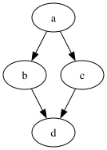
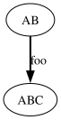
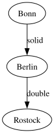
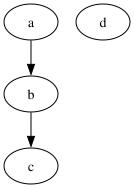
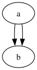
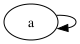
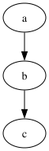

# gallery

A visual gallery of the published [examples](../examples/README.md): each
example shown three ways — the graph source, the CLI's ASCII render (the
byte-verified `expected.txt`), and an SVG rendering.

## How the SVG is produced

Upstream Graph::Easy v0.69 ships no SVG module, so SVG is out of scope for
gently's v1 renderers. What you see here instead is gently's **own library
Graphviz renderer** (`gently_core::render::graphviz`, spec-pinned
`ge.graphviz_render`) emitting DOT source, piped through `dot -Tsvg`:

```text
examples/<name>/input.gv → text parser → graphviz render (DOT) → dot -Tsvg → docs/gallery/<name>.svg
```

The committed SVGs are drift-gated: `just gallery-verify` regenerates every
SVG through exactly this path and fails on any byte mismatch — the same
culture as `just examples-verify` for the ASCII output.

---

## diamond

Input:

```text
[ a ] --> [ b ]
[ a ] --> [ c ]
[ b ] --> [ d ]
[ c ] --> [ d ]
```

CLI ASCII render:

```text
+---+     +---+     +---+
| a | --> | b | --> | d |
+---+     +---+     +---+
  |                   ^
  |                   |
  v                   |
+---+                 |
| c | ----------------+
+---+
```

SVG: 

## edge-attributes

Input:

```text
[ AB ] --> { style: bold; label: foo; } [ ABC ]
```

CLI ASCII render:

```text
+----+  foo   +-----+
| AB | #####> | ABC |
+----+        +-----+
```

SVG: 

## edge-styles

Input:

```text
[ Bonn ] -- solid --> [ Berlin ]
[ Berlin ] == double ==> [ Rostock ]
```

CLI ASCII render:

```text
+------+  solid   +--------+  double   +---------+
| Bonn | -------> | Berlin | ========> | Rostock |
+------+          +--------+           +---------+
```

SVG: 

## isolated-node

Input:

```text
[ a ] --> [ b ]
[ d ]
[ b ] --> [ c ]
```

CLI ASCII render:

```text
+---+     +---+     +---+
| a | --> | b | --> | c |
+---+     +---+     +---+
+---+
| d |
+---+
```

SVG: 

## parallel-edges

Input:

```text
[ a ] --> [ b ]
[ a ] --> [ b ]
```

CLI ASCII render:

```text

  +---------+
  |         v
+---+     +---+
| a | --> | b |
+---+     +---+
```

SVG: 

## self-loop

Input:

```text
[ a ] --> [ a ]
```

CLI ASCII render:

```text

  +--+
  v  |
+------+
|  a   |
+------+
```

SVG: 

## simple-chain

Input:

```text
[ a ] --> [ b ]
[ b ] --> [ c ]
```

CLI ASCII render:

```text
+---+     +---+     +---+
| a | --> | b | --> | c |
+---+     +---+     +---+
```

SVG: 

---

## Where the truth lives

- The ASCII renders above are the committed, byte-verified
  `examples/<name>/expected.txt` files — `just examples-verify` keeps them
  honest.
- Known rendering gaps and hard cases are tracked in
  [docs/known-hard-cases.md](known-hard-cases.md).